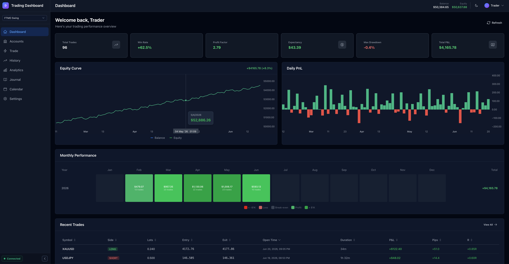
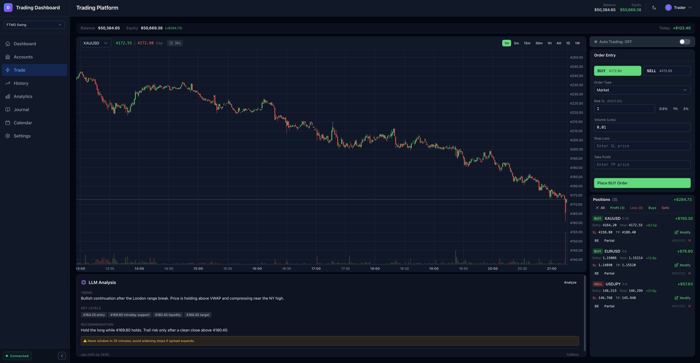
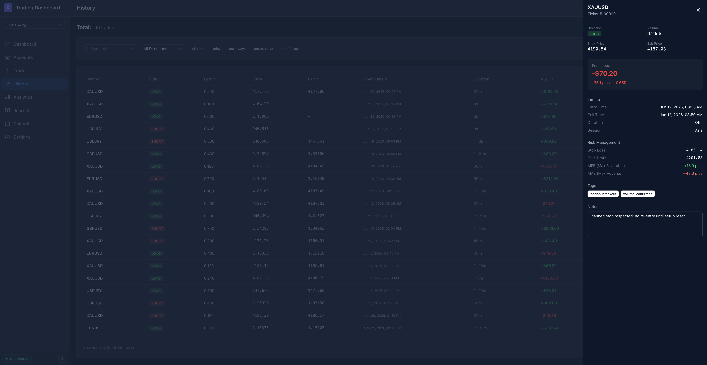
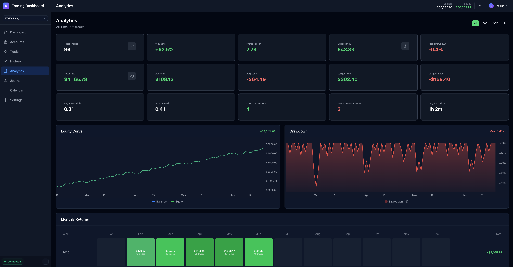
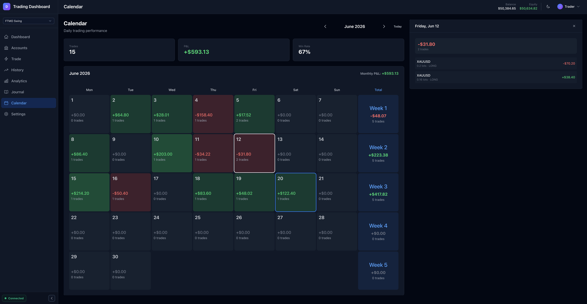
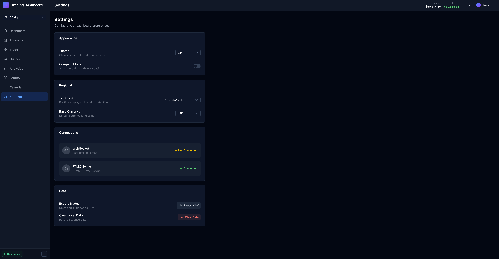

<h1 align="center">MegaTrader</h1>

<p align="center">
  
  
  
  
  
  
  
  
</p>

MegaTrader is a dual-mode algorithmic trading system that connects real-time market data, footprint order-flow, and multi-modal chart analysis with a Large Language Model (LLM) decision engine.

The system bridges institutional-grade execution terminals (MetaTrader 5 and Sierra Chart) running on Windows with a high-performance Python backend, vector database memory, and a web dashboard running in Docker containers.

---

## System Architecture

```
                                  +-----------------------------------+
                                  |         Nuxt 4 Dashboard          |
                                  |     (HTTP API / WebSockets)       |
                                  +-----------------+-----------------+
                                                    |
                                                    v
+------------------------+        +-----------------+-----------------+        +------------------------+
|   MetaTrader 5 EA      |  ZMQ   |         FastAPI Backend           |  HTTP  |   LLM & RAG Service    |
|   (Windows native)     |<======>|      (Orchestrator & State)       |<======>|   (Gemini + Qdrant)    |
+------------------------+        +--------+-----------------+--------+        +------------------------+
                                           |                 |
                                           v                 v
                                  +--------+--------+      +-+------+
                                  |   TimescaleDB   |      | Shared | <--- Sierra Chart
                                  | (PostgreSQL DB) |      | Images |      Chart Snapshots
                                  +-----------------+      +--------+
```

The system is split into three main parts:
1. **Trading Clients (MT5 & Sierra Chart):** Handle real-time price feeds, order flow aggregation, chart rendering, and trade execution.
2. **Backend Server (FastAPI):** Serves as the central controller. It manages market states, holds active buffers, runs risk management filters, persists transaction history, and broadcasts real-time updates via WebSockets.
3. **LLM Service (FastAPI):** A self-contained AI microservice that processes multi-modal chart images and text-based trading lessons to generate market decisions.

---

## Key Features

### 1. Dual-Mode Operations
* **Manual Analysis Mode:** The LLM service reads market snapshots and provides technical analysis, support/resistance mapping, and directional outlooks on the Web Dashboard. Manual trading buttons remain active for the user.
* **Auto Trading Mode:** The system runs as a fully automated agent. The LLM service issues structured `BUY`, `SELL`, or `HOLD` decisions. The backend validates these decisions against strict risk parameters before sending the order to MT5.

### 2. Multi-Modal Context Ingestion
Whenever price enters a monitored trade zone, Sierra Chart triggers a screenshot utility to capture three distinct chart layouts:
* **1-Minute Chart:** Captures immediate price action and candlestick patterns.
* **TPO (Time Price Opportunity) Profile:** Shows key intraday structure, value areas, and points of control.
* **Footprint Chart:** Reveals order flow imbalances, delta divergence, and bid/ask volume distribution.

### 3. RAG-Based Trading Memory (Retrieval-Augmented Generation)
* The LLM service uses local embedding models to convert charts (using CLIP) and text trading rules/lessons (using Sentence-Transformers) into vector representations.
* When evaluating a new setup, the system queries a Qdrant vector database to retrieve the top relevant past trades and lessons.
* The retrieved memory is sent alongside the current chart snapshots to the Gemini API, enabling context-aware decisions based on historical performance.

### 4. ZeroMQ High-Speed Bridge
Using ZeroMQ sockets, the system maintains low-latency communication between Windows trading platforms and the Linux-based backend:
* **PUB/SUB (Ports 5555, 5557):** Streams high-frequency tick prices and heartbeats from MT5.
* **PUSH/PULL (Ports 5556, 6002):** Ingests asynchronous trade events and footprint bar summaries.
* **REQ/REP (Ports 5558-5561, 6001):** Handles transactional actions like fetching order history, requesting bars, and executing orders.

### 5. Strict Risk Management Filter
To prevent AI hallucinations from causing trading losses, the backend acts as a hard gatekeeper:
* Enforces maximum daily drawdown limits and leverage boundaries.
* Automatically calculates position sizes based on a user-defined risk percentage per trade.
* Automatically attaches Stop Loss and Take Profit levels to every order.
* Open positions are tracked in real-time to compute Maximum Favorable Excursion (MFE) and Maximum Adverse Excursion (MAE).

### 6. Cloud Infrastructure & Security (IaC)
* Provisioned on AWS using modular **Terraform** infrastructure as code.
* Uses ECS (Elastic Container Service) for container orchestration, RDS (PostgreSQL/TimescaleDB) for data persistence, and ElastiCache (Redis) for active caching.
* Hosts Windows-based execution nodes (MT5 and Sierra Chart) on isolated Windows EC2 instances with zero public IP exposure and IMDSv2 security policies.
* Employs a 3-tier subnet isolation layout (Public ALB → Private ECS → Isolated RDS/Cache/Trading nodes) to secure transaction pathways.

---

## Data Pipeline Flow

```
[MT5 Terminal] ---> (ZMQ PUB) ---> [MarketDataSubscriber] ---> [EventBus] ---> [TickBuffer] ---> (WebSockets) ---> [Web Dashboard]
                                                                     |
                                                                     +--> [MfeMaeTracker] (Updates Open Positions)
```

1. **Tick & Bar Ingestion:** Live prices are published by MT5, received by the backend subscriber, validated into Pydantic models, and pushed into active ring buffers.
2. **WebSocket Broadcast:** The backend pushes tick updates to the dashboard for live chart rendering and floating P&L calculations.
3. **Snapshot Trigger:** When target criteria are met, Sierra Chart saves chart images to a shared folder and notifies the backend.
4. **LLM Evaluation:** The backend packages the snapshots and calls the LLM service. The service performs vector searches, queries Gemini, and returns a structured JSON payload conforming to Pydantic schemas.
5. **Execution Gate:** If in Auto Mode, the backend checks risk constraints. If valid, a REQ message is sent to MT5 to open the position. All execution results are persisted in a TimescaleDB database.

---

## Tech Stack

* **Frontend:** Nuxt 4 (Single Page Application), Vue 3, Pinia, Tailwind CSS, Nuxt UI, Lightweight Charts (HTML5 Canvas charts).
* **Backend:** FastAPI, Python, ZeroMQ (pyzmq), SQLAlchemy.
* **Database & Memory:** TimescaleDB (PostgreSQL), Qdrant Vector Database.
* **Machine Learning / AI:** Gemini API, CLIP (ViT-B/32) for visual embeddings, Sentence-Transformers for text embeddings.
* **DevOps & Infrastructure:** Docker & Docker Compose, Terraform, AWS.

---

## Screenshots

Here is a visual overview of the MegaTrader dashboard and trading interface:

<div align="center">
  <h3>1. Dashboard Performance Overview</h3>
  
  
  <h3>2. Real-Time Trading Terminal</h3>
  

  <h3>3. Historical Trades</h3>
  

  <h3>4. Historical Trade Details</h3>
  

  <h3>5. Detailed Analytics & Equity Curves</h3>
  

  <h3>6. Trading Journal</h3>
  

  <h3>7. Performance Calendar View</h3>
  

  <h3>8. System Settings & Configuration</h3>
  
</div>

