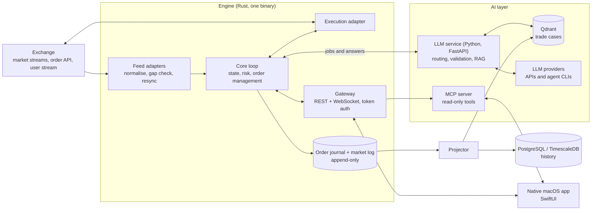
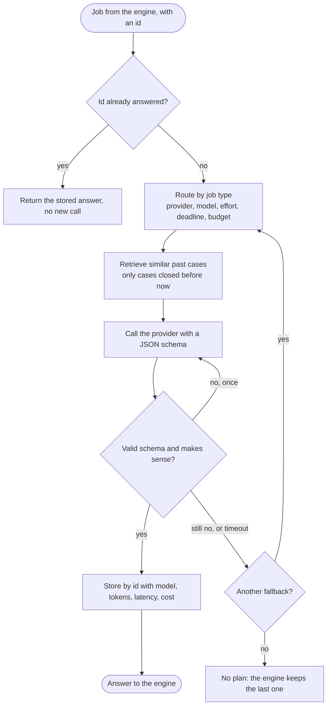
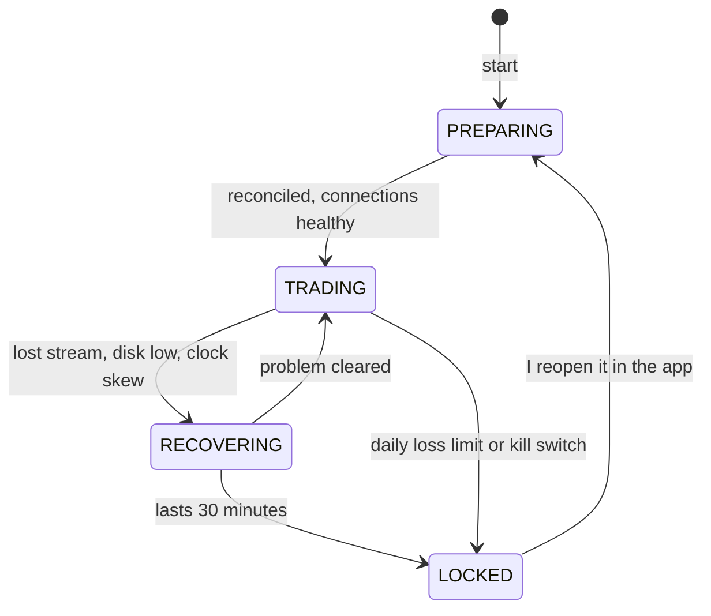
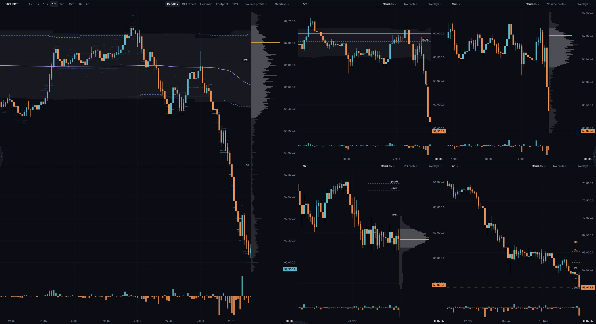
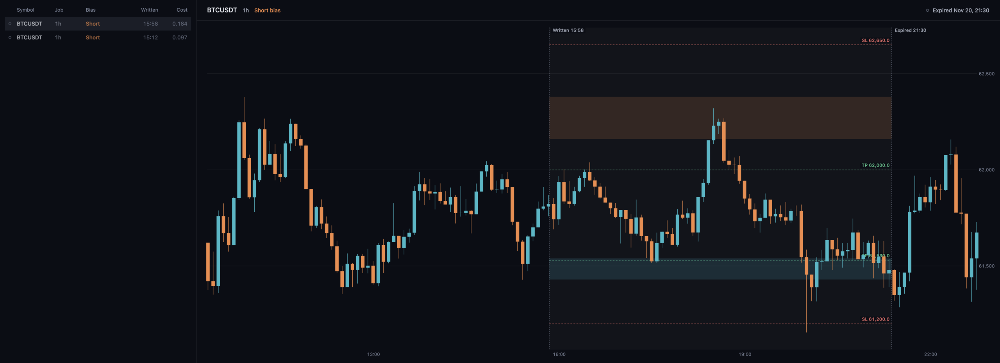
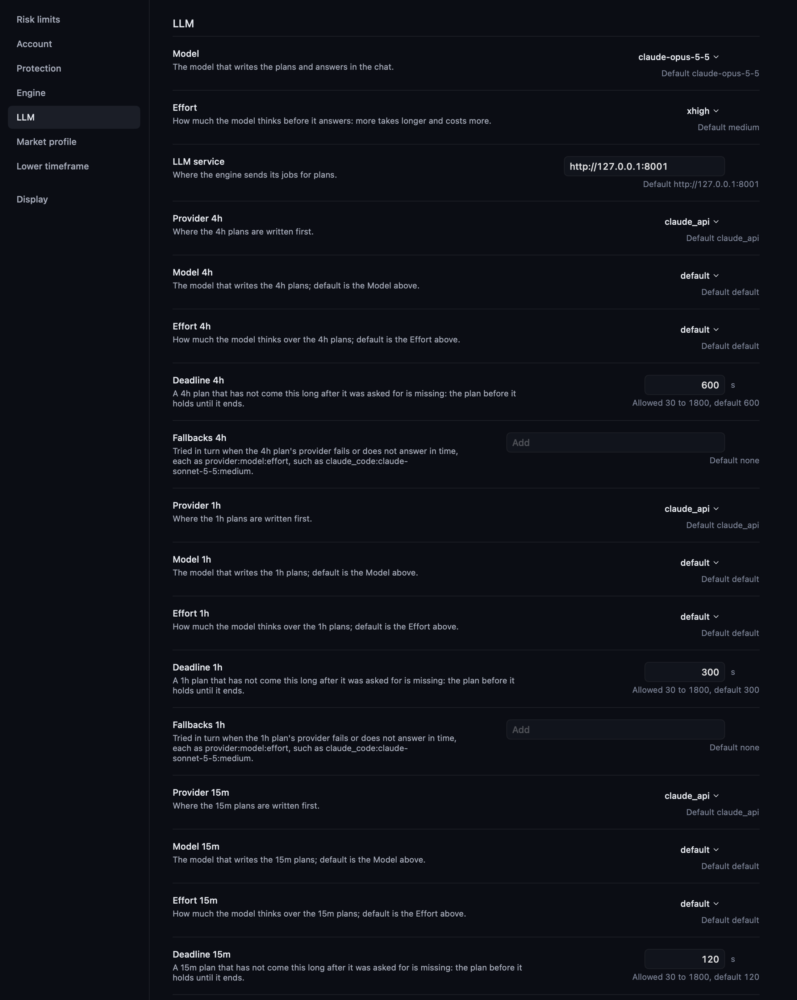
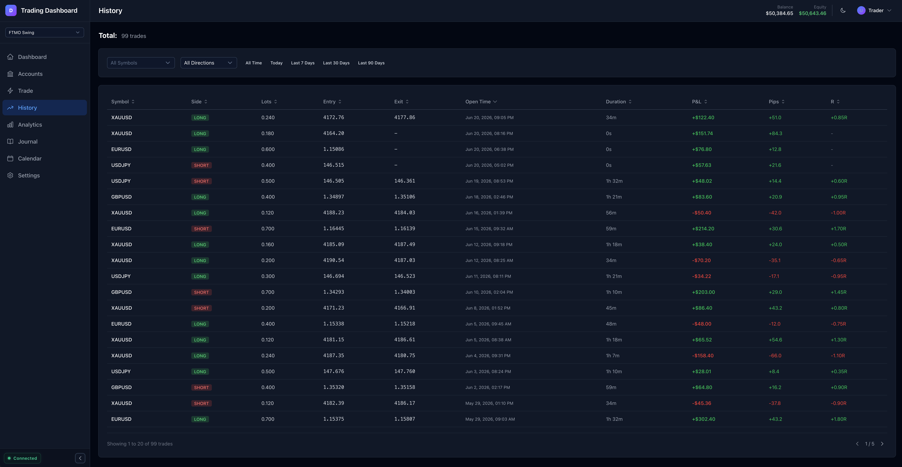
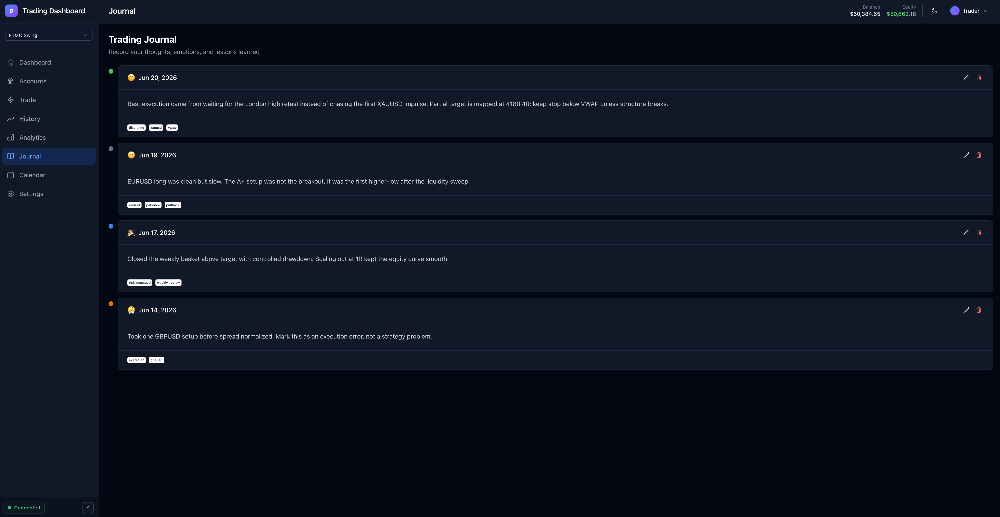

<h1 align="center">MegaTrader</h1>

  
  
  
  
  
  
  

MegaTrader is an AI trading system for crypto futures. A Rust engine reads live market data, keeps all trading state, and places every order. A team of LLM agents plans trades and decides entries, but only inside hard limits that the engine checks. A native macOS app shows what the engine and the agents are doing and lets me step in at any time.

The source is private. This page describes the architecture and the AI orchestration. It leaves out the trading logic itself.

---

## Architecture

A few rules shape the whole system.

- The engine is a single Rust binary. Its core loop is one task that handles events in arrival order, so it needs no locks. The app, the LLM service and the MCP server only see the engine through the gateway.
- Timers enter the core as events and are logged. Replaying the same logs gives the same state, byte for byte, so any problem can be replayed and checked.
- No order waits for the LLM. The core hands each job to a separate task and moves on. An answer comes back as an event, which the core journals before it acts on it.
- On any failure the engine stops opening positions. Every position's stop-loss lives on the exchange, so it holds even if the engine dies.
- No model output reaches the exchange until the engine has checked it against its own limits.

## AI orchestration

The LLM is called on events, not on a schedule. Three agents share the work, and each one uses the cheapest model that does its job well.

| Agent | Model | When it runs | What it returns |
|---|---|---|---|
| Market narrator | small, low effort | when the market facts change, at most every 15 minutes | a short account of the market state, written from facts the engine computes |
| Analyst | strong, high effort | when the engine detects a significant market event | a trading plan as structured JSON |
| Entry agent | strong, low effort | at each one-minute close while price is inside a planned zone | enter, wait or skip, with a stop-loss and a reason |
| Assistant | chosen in settings | when I ask in the app | answers about plans, trades and the journal, through MCP |

The engine computes every number itself. The models read those facts and write text or JSON. They never compute prices or sizes.

### Routing and fallback

Each job type has its own provider, model, effort, deadline, fallback list and daily cap, all set in the app. A job goes to an LLM API first and can fall back to an agent CLI running in a read-only sandbox. If every route fails or misses the deadline, the engine keeps the previous plan or places nothing.

### Guardrails on every answer

- Every answer is checked against a JSON schema and for meaning, and asked again once if it fails.
- The engine checks each plan against its own bounds and rejects anything outside them.
- An entry decision is clamped: the engine sizes the order, limits the stop-loss, and runs the same risk checks as a manual order.
- Jobs are idempotent by id. After a restart the engine asks again for any open request by the same id, and a late answer is dropped.
- Every request and answer is journaled with its model, latency and cost. The app shows today's LLM spend by job type.
- Long system prompts are cached, which keeps the entry agent's per-minute calls cheap.

### Cost and speed, measured live

| Job | Typical latency | Cost |
|---|---|---|
| Trading plan | 11 to 58 s, depending on reasoning effort | US$0.04 to 0.18 |
| Entry decision | about 3 s | about US$0.02 |
| Market narrative, two symbols | about 18 s | runs on a subscription plan |

## RAG: memory of past trades

The analyst does not start from zero. Every closed trade becomes a case in Qdrant, built from recorded data and never from an agent's memory.

- A projector reads the order journal and the market log in order and writes trades, plans and outcomes to PostgreSQL/TimescaleDB. It keeps a checkpoint, so it resumes where it stopped.
- Each closed trade is stored as a case: the context at entry, the plan, and what happened.
- Retrieval uses hybrid search, fuses the results with reciprocal rank fusion, reranks them, and keeps the top few.
- A point-in-time filter only returns cases that closed before the decision, so nothing leaks from the future.
- If Qdrant or PostgreSQL is down, the engine carries on and the agents simply get no past cases.

## MCP: asking the system in plain words

A read-only MCP server sits on top of the gateway and runs only on my machine. Its tools read the engine's status, the plans, the trades and the journal. The app's Chat uses it, so I can ask things like "why did the agent leave that zone?" or "which session lost most this week?".

Nothing that changes money goes through MCP. It cannot place an order, move a stop-loss or change a setting. At most it suggests a change, which I confirm in the app.

## Reliability

- The engine's trade store matched the exchange's public archive trade for trade over a full day, about 1.7 million trades per symbol, along with every cell of the one-minute footprint.
- A live hour replayed twice gives identical output, and a snapshot plus the log tail matches a full replay.
- The order journal is written to disk before an order leaves (p50 4 ms on the Mac). After a restart or a lost stream, the engine reconciles with the exchange before it trades again.
- The stop-loss is on the exchange before the entry, so a position is never open without one.
- A watchdog stops a stuck engine, an outside heartbeat monitor notices if the whole machine goes quiet, and alerts go to my phone.
- The engine is always in one of four modes, and it never opens a position outside TRADING.

## Native macOS app

The app is written in SwiftUI with an AppKit chart view and no third-party dependencies. It is a thin client: it holds no keys and no trading logic, and draws only what the engine sends. The gateway batches updates 10 to 20 times a second and drops batches for a slow client, so the charts can never slow the engine down.

It covers live charts (footprint, volume and TPO profiles, liquidity heatmap, DOM), the active plans with each zone's latest agent decision, positions and manual orders with the same risk checks as the agents, an activity feed, history, analytics, a calendar, a trading journal, settings, and a Lock button.

## Screenshots

  <h4>Live charts across timeframes</h4>
  

  <h4>A plan from the analyst, drawn on the chart with its cost</h4>
  

  <h4>LLM routing: provider, model, effort, deadline and fallbacks for each job type</h4>
  

## Tech stack

| Layer | Technology |
|---|---|
| Engine | Rust, tokio, WebSocket and REST clients, append-only journals, snapshots and replay |
| AI | Python, FastAPI, LLM APIs with structured output, agent CLIs, prompt caching, MCP, Qdrant |
| Data | PostgreSQL with TimescaleDB, SQLite |
| App | Swift 6, SwiftUI, AppKit |
| Operations | macOS launchd services, phone alerts, external heartbeat monitor, daily backups |

---

<b>Version 1: the Python system</b>

The first version was a Python and FastAPI backend that connected MetaTrader 5 and Sierra Chart over ZeroMQ, with a Nuxt web dashboard. When price entered a monitored zone, Sierra Chart captured chart snapshots, and the LLM service analysed them with the help of a Qdrant memory of past trades and lessons. Zone-triggered captures and stream throttling cut LLM API usage by over 80%. The infrastructure was written in Terraform for AWS (ECS, RDS, S3, IAM, VPC).

Version 2 replaces it with the Rust engine, the agents and the native app described above.

  <h4>Dashboard overview</h4>
  

  <h4>Trading terminal</h4>
  

  <h4>Historical trades</h4>
  

  <h4>Trade details</h4>
  

  <h4>Analytics and equity curves</h4>
  

  <h4>Trading journal</h4>
  

  <h4>Calendar</h4>
  

  <h4>Settings</h4>
  

